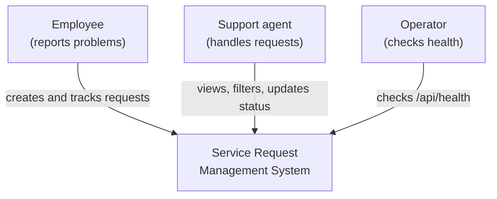
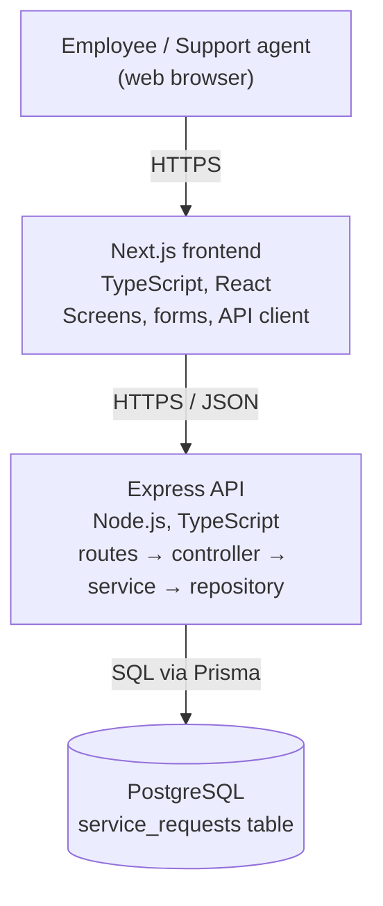
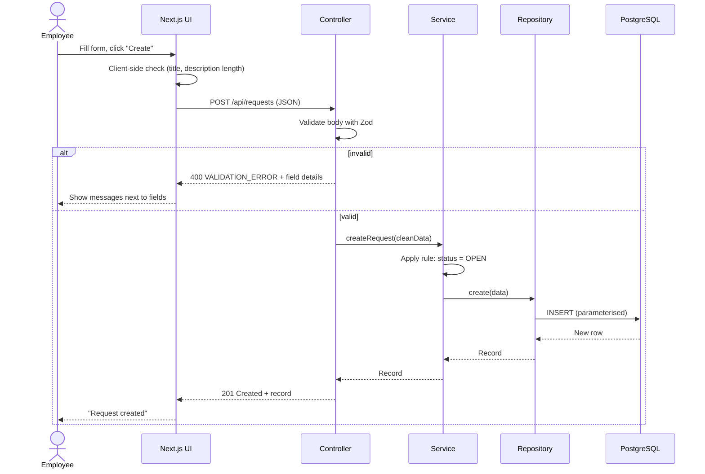

# Architecture — Service Request Management System

> Status: Designed on Day 1; built on Days 2–5 and the code follows these boundaries (see section 8). Deployment: [deployment.md](deployment.md). The Mermaid diagrams below render on GitHub. **TODO:** redraw the container diagram in draw.io or Excalidraw and save `docs/architecture.png` plus the editable source file.

## 1. Overview

The system is a **modular monolith**: one Next.js frontend, one Express API, and one PostgreSQL database. The API is organised by feature (`modules/requests`) and each feature is split into layers: **routes/controller → service → repository**.

## 2. Context diagram (C4 level 1)



No external systems in the MVP (no email, no SSO).

## 3. Container diagram (C4 level 2)



The browser never talks to the database directly. Only the API holds the database connection string.

## 4. Layer responsibilities

| Layer | Owns | Never does |
|---|---|---|
| Frontend (Next.js) | Screens, form state, client-side validation for comfort, calling the API, showing loading/empty/error/success | Hold DB credentials; be the only place rules are checked |
| Routes / controller | Read the HTTP request, validate input (Zod), choose status code, send JSON | Business decisions, SQL |
| Service | Business rules (new requests start `OPEN`, allowed status transitions) | Touch `req`/`res`, write SQL |
| Repository | Database queries only (Prisma) | Business rules, HTTP |
| Database | Data, constraints (NOT NULL, lengths, enums), index on `status`, migrations | Be reachable from the browser |
| Cross-cutting | Config (env vars), error handler, logging, validation helpers | Be copy-pasted per module |

**Dependency direction:** controller → service → repository → database. Never backwards.

**Where things belong:**
- Validation: at the API edge (controller, Zod) **and** again in the database (constraints).
- Business rules: service.
- Persistence: repository.

## 5. Request flow — "Create request"



Step by step:

1. The user fills in the form and clicks **Create**.
2. The frontend checks the fields quickly (for comfort only) and sends `POST /api/requests` with a JSON body through the single API client.
3. The controller validates the body with the Zod schema. If invalid → `400` with the standard error shape.
4. The controller passes clean data to the service.
5. The service applies business rules — a new request always starts as `OPEN`.
6. The repository saves the record with Prisma (parameterised query).
7. The API returns `201 Created` with the new record.
8. The frontend shows a success message only after the `201`. On network or server error it shows an error message instead.
9. Unexpected errors go to the error handler: full details in the server log, generic `500` message to the client.

### 5.1 Trace — "Change status" through every layer (as built on Day 4)

| # | Layer | File | What happens |
|---|---|---|---|
| 1 | UI | `frontend/src/features/requests/RequestDetails.tsx` | User clicks **Mark as Resolved** → `changeStatus("RESOLVED")` → `api.updateStatus(id, "RESOLVED")`. The screen is **not** changed yet. |
| 2 | API client | `frontend/src/lib/api-client.ts` | Sends `PATCH /api/requests/{id}/status` with `{"status":"RESOLVED"}`. A network failure becomes `ApiError(0, "NETWORK_ERROR")`. |
| 3 | Route | `backend/src/modules/requests/routes.ts` | Matches `PATCH /:id/status` → `controller.changeStatus`. |
| 4 | Controller | `backend/src/modules/requests/controller.ts` | Validates the id (UUID) and body (status enum) with Zod → `400 VALIDATION_ERROR` if wrong. |
| 5 | Service | `backend/src/modules/requests/service.ts` | Loads the request (`404 REQUEST_NOT_FOUND` if missing), checks `canTransition(current, next)` from `status-rules.ts` (`409 INVALID_STATUS_TRANSITION` if not allowed). |
| 6 | Repository | `backend/src/modules/requests/repository.ts` | `prisma.serviceRequest.update(...)` — a parameterised `UPDATE`; Prisma sets `updated_at`. |
| 7 | Database | `service_requests` table | Row saved; enum type rejects any value outside the list. |
| 8 | Back up | controller → client → UI | `200` + updated record → page shows the new status and "Status changed to Resolved." On `409` the page keeps the old status and shows the server's message, e.g. "Cannot change status from OPEN to RESOLVED". |

Errors travel up the same path: the service throws an `AppError` → the error handler sends the standard JSON → the API client turns it into an `ApiError` → the component shows its message.

## 6. Why this architecture fits

- One trainee, 5 days, small internal app → one deployable backend is simplest to run, test and explain.
- Layers give each type of code one clear home, so business rules can be unit tested without starting a server.
- A separate Express API (instead of only Next.js API routes) can be tested with Supertest without the UI and matches the guide's stack.

See [ADR-001](decisions/ADR-001-architecture.md) for the decision record, alternatives, trade-off and risk.

## 7. Known risks

- **No login in the MVP:** anyone who can reach the app on the network can create requests and change statuses. Accepted for training; listed as future work.
- **Single database instance:** if PostgreSQL is down, the whole app is down. Since Day 5 every endpoint returns `503 SERVICE_UNAVAILABLE` so clients know it is temporary, and the API reconnects by itself.
- **Single API instance with an in-memory rate limiter:** if the API were run as several copies, each would count requests separately (a shared store such as Redis would be needed).
- **No automated frontend tests:** the UI was checked manually in the browser; the API and business rules are covered by automated tests.

## 8. Implementation map (as built)

```
frontend/src/
├── app/
│   ├── layout.tsx                 header + page frame
│   └── requests/
│       ├── page.tsx               /requests        list
│       ├── new/page.tsx           /requests/new    create form
│       └── [id]/page.tsx          /requests/{id}   details (id read on the server)
├── features/requests/             RequestList, RequestForm, RequestDetails, StatusBadge, types
└── lib/api-client.ts              the ONLY place that calls fetch → ApiError

backend/src/
├── app.ts                         builds the Express app (helmet, CORS, JSON limit, routes, error handler)
├── server.ts                      starts listening; closes the DB on shutdown
├── config/environment.ts          validates env variables at start-up
├── database/connection.ts         one shared Prisma client
├── middleware/                    AppError, error handler (one error shape),
│                                  rate limit, database-outage detection (503)
└── modules/
    ├── health/routes.ts           GET /api/health (200 / 503)
    └── requests/                  routes → controller → service → repository
                                   + schema.ts (Zod) + status-rules.ts

backend/tests/
├── unit/                          status rules, service (fake repository), validation
└── integration/                   every endpoint over HTTP with a real test database
```

**Boundary checks (does the code follow the diagram?)**

| Rule from section 4 | Where it holds |
|---|---|
| Browser never talks to the database | Only `backend/` has `DATABASE_URL`; the frontend only knows `NEXT_PUBLIC_API_URL` |
| Controller does HTTP only | `controller.ts` validates and picks status codes; no Prisma import |
| Service has no `req`/`res` or SQL | `service.ts` imports only the repository, status rules, `AppError` and type definitions — unit-tested with a fake repository |
| Repository does queries only | `repository.ts` contains only Prisma calls |
| Dependencies point one way | controller → service → repository → database; nothing imports "upwards" |
