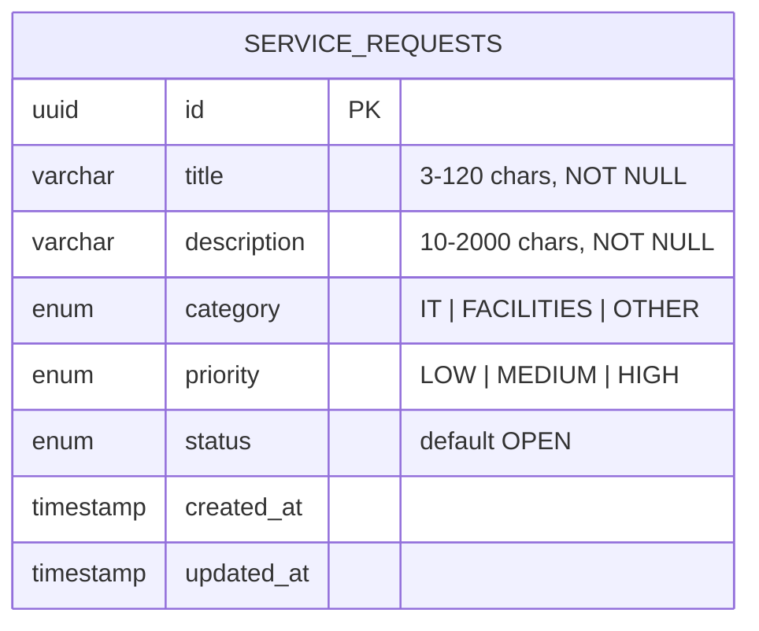
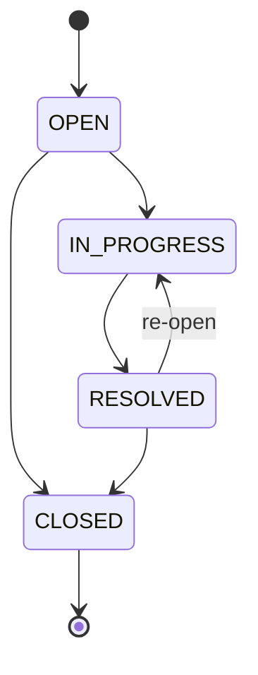

# Data Model — Service Request Management System

> Status: Draft (Day 1).

## 1. Table: `service_requests`

| Column | Type | Rule |
|---|---|---|
| `id` | UUID | Primary key, generated automatically |
| `title` | VARCHAR(120) | Required; trimmed; 3–120 characters |
| `description` | VARCHAR(2000) | Required; trimmed; 10–2000 characters |
| `category` | enum `Category` | `IT`, `FACILITIES` or `OTHER` |
| `priority` | enum `Priority` | `LOW`, `MEDIUM` or `HIGH` |
| `status` | enum `RequestStatus` | `OPEN`, `IN_PROGRESS`, `RESOLVED`, `CLOSED`; default `OPEN` |
| `created_at` | timestamp | Set by the database on insert; never sent by the client |
| `updated_at` | timestamp | Set by the server on every update; never sent by the client |

**Index:** `status` (the list is filtered by status).

**Primary key choice:** UUID everywhere — ids cannot be guessed by counting and can be created without asking the database for the next number.

## 2. ER diagram

**Future (not in MVP):** a `users` table, with `service_requests.created_by` and `assigned_to` as foreign keys to `users.id`, and a `comments` table linked to `service_requests.id`.

## 3. Validation in two places

| Rule | API (Zod) | Database |
|---|---|---|
| Title required, 3–120 chars | `z.string().trim().min(3).max(120)` | `NOT NULL`, `VARCHAR(120)` |
| Description required, 10–2000 chars | `z.string().trim().min(10).max(2000)` | `NOT NULL`, `VARCHAR(2000)` |
| Category / priority / status in fixed list | `z.enum([...])` | PostgreSQL enum types |
| Timestamps | Not accepted from client | Defaults / auto-update |

## 4. Status workflow (business rule)

| From | Allowed next statuses |
|---|---|
| `OPEN` | `IN_PROGRESS`, `CLOSED` |
| `IN_PROGRESS` | `RESOLVED` |
| `RESOLVED` | `CLOSED`, `IN_PROGRESS` |
| `CLOSED` | *(none — final)* |

- Any other change (e.g. `CLOSED → OPEN`, `OPEN → RESOLVED`) is rejected with `409 INVALID_STATUS_TRANSITION`.
- Setting the same status again (e.g. `OPEN → OPEN`) is also rejected with `409`.
- This rule lives in the **service** layer (as a plain lookup table so it is easy to unit test), not in the controller or the UI.
